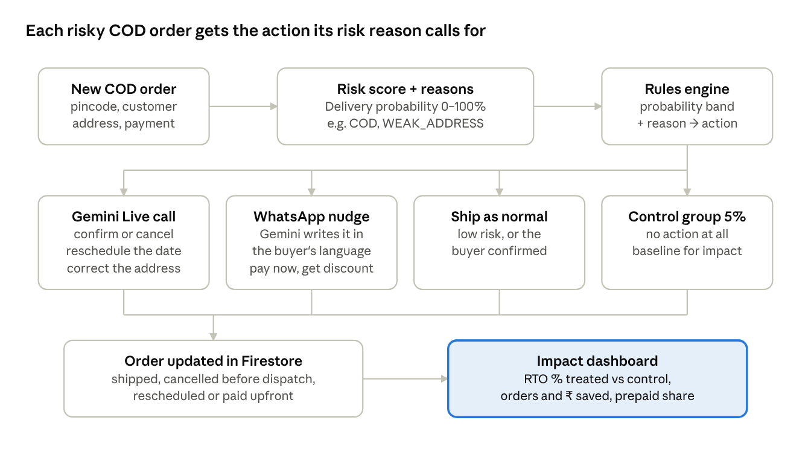
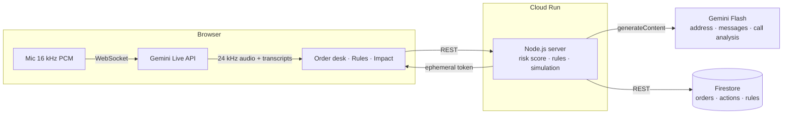

# RTO Shield

**Predict and prevent return-to-origin (RTO) on e-commerce orders, before the parcel leaves the warehouse.**

Built for the Google Cloud **AI Builder Cup 2026** · Theme 2: Retail & Commerce · Team Prompt Avengers

RTO Shield scores every order, COD or prepaid, for the chance that it comes back undelivered, and explains why. A rules engine then picks the right action, and **Gemini carries it out**:

- **Gemini Live voice call** in Hindi, Hinglish or English that confirms the order, fixes the address and agrees on a delivery day
- **WhatsApp payment nudge** that converts a COD order to prepaid with a small discount, or collects a **token amount** upfront from customers who have returned COD orders before
- **Address clean-up** that turns "near Sharma ji dairy, gali no 3" into a courier-ready address, plus the exact question to ask the customer

An impact dashboard compares the orders we acted on with a **control group we deliberately left untouched**, so the savings are measured, not claimed.

---

## The problem

| Fact | Figure |
|---|---|
| Share of Indian e-commerce orders paid cash on delivery | 60–65% |
| COD orders that end in RTO | ~26% (up to ~35% in some cities) |
| Prepaid orders that end in RTO | under 3% |
| Logistics cost of one RTO | ₹180–240, before lost sales and stuck stock |
| RTOs caused by bad addresses | 18–24% |

Sources: ET Prime 2024 and Shipway FY25 via [Razorpay](https://razorpay.com/blog/cash-on-delivery-and-the-challenges/) and [Amazon Shipping](https://shipping.amazon.in/blog/what-is-rto-how-to-reduce-return-to-origin); bepragma.ai 2025. Secondary sources, not audited.

A brand shipping 1,000 COD orders a day at 26% RTO loses about ₹52,000 a day, roughly ₹1.9 Cr a year, in logistics alone.

**Who it's for:** operations heads at D2C and product brands with high RTO (fashion, footwear, beauty, home, electronics) selling into Tier-2 and Tier-3 India, and the same COD-heavy markets across the region (Indonesia, the Philippines, Vietnam).

## How it works



1. **Score.** Every new order gets a delivery probability based on pincode RTO history, payment mode, customer history, address quality and order pattern.
2. **Explain.** Reason codes (`HIGH_RISK_PINCODE`, `COD`, `NEW_CUSTOMER`, `PAST_RTO`, `WEAK_ADDRESS`, `ORDER_ANOMALY`) say *why* an order is risky.
3. **Act.** Ops-defined probability bands plus the reason pick the action:

| Situation | Action |
|---|---|
| Below the call threshold | Gemini Live voice call (COD or prepaid) |
| Below the call threshold, COD, past RTOs | Token amount upfront (part-prepaid), or hold the order |
| Medium risk, COD | WhatsApp offer to pay in full now for a small discount |
| Weak address | Gemini address check and fix |
| Low risk | Ship as normal |
| Random share of risky orders | Control group: no action |

4. **Measure.** The dashboard compares RTO rates for orders we acted on against the control group, by action and by pincode tier.

## Where Gemini and Google Cloud are used

| Service | What it does in RTO Shield |
|---|---|
| **Gemini Live API** | Real-time voice call in the browser. The model plays "Riya" from the brand, follows a per-order script (confirm, fix address, reschedule, payment offer), and switches language to match the customer. Both sides are transcribed live. |
| **Gemini (Flash)** | Reads the call transcript and returns a structured result (outcome, sentiment, intent score, corrected address, reschedule date, payment choice), which is written back to the order. Also checks and rewrites addresses, and drafts WhatsApp messages in the customer's language. |
| **Cloud Run** | Hosts the whole app: one Node.js container with zero npm dependencies. |
| **Firestore** | Stores order state, every action taken, call results and the ops rules. |

The Gemini API key never reaches the browser. The server creates a single-use, short-lived token for each Live session.

## Architecture



## Run it locally

Requires Node.js 20 or newer. There is nothing to install.

```bash
export GEMINI_API_KEY=your_key   # optional: without it the app runs in offline mode
node server.js                   # http://localhost:8080
```

Without Firestore credentials the app keeps state in memory. Without a Gemini key, AI features fall back to simple offline answers so the UI can still be explored.

| Variable | Default | Purpose |
|---|---|---|
| `GEMINI_API_KEY` | none | Gemini API key from Google AI Studio |
| `TEXT_MODEL` | `gemini-flash-latest` | Model for address checks, messages and call analysis |
| `LIVE_MODEL` | `gemini-3.8-live` | Gemini Live model for the voice call |
| `LIVE_API_VERSION` | `v1beta` | API version for Live tokens and WebSocket |
| `FIRESTORE_DATABASE` | `(default)` | Firestore database ID |

## Deploy to Cloud Run

See [DEPLOY.md](DEPLOY.md). Short version, from Google Cloud Shell:

```bash
gcloud run deploy rto-shield --source . --region asia-south1 \
  --allow-unauthenticated --max-instances 1 \
  --set-env-vars GEMINI_API_KEY=YOUR_KEY
```

## Project structure

```
server.js            HTTP server and API routes
server/data.js       synthetic orders (fixed seeds, fictional brand)
server/engine.js     risk score, reason codes, rules, impact simulation
server/ai.js         every Gemini prompt, with offline fallbacks
server/google.js     REST clients for Gemini, Gemini Live tokens and Firestore
public/              front end (plain HTML, CSS and JavaScript)
public/live.js       Gemini Live voice call: mic capture, playback, transcripts
docs/                flow diagram and project overview
```

## Data and honesty notes

- All data is **synthetic**: the brand (Saanjh Fashion), customers, phone numbers and orders are made up and generated from fixed seeds.
- The impact dashboard **simulates** 30 days of outcomes on 4,000 synthetic orders, using response-rate assumptions that are shown on the page. The live queue (36 orders) is real app state: calls, messages and address fixes there are performed by Gemini and stored in Firestore.
- WhatsApp messages are drafted by Gemini and shown as previews. Sending needs the WhatsApp Business API, which is future work.
- The voice call runs in the browser so judges can try it. Placing real phone calls (for example through a telephony provider bridged to Gemini Live) is future work.

## Future work

- Real outbound phone calls and WhatsApp delivery
- Train the score on a brand's own order history; per-brand calibration
- Follow-up after a failed delivery attempt (NDR): reschedule calls the same day
- Courier and checkout integrations (Shopify, Shiprocket and similar)
- Live A/B measurement with the control group on real orders

## Team

Prompt Avengers: Harshvardhan Singh, Ajay Kumar

## License

MIT
